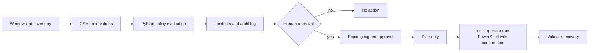

# Enterprise Infrastructure Automation & Self-Healing Lab

**Tier III/Tier IV portfolio demonstration | Windows Server • PowerShell • Python • service health • human-approved recovery • auditability**

> **Status: Offline simulation, Python unit tests and CLI integration test verified. Actual Windows VM/Hyper-V deployment and remediation are NOT claimed as tested.** This project does not touch any live system unless a lab operator deliberately runs a PowerShell script on their own isolated Windows machine.

## Why this matters

Demonstrates the engineering lifecycle: define a health policy, collect telemetry, detect a deviation, open an incident, require authorization, prepare an execution plan, validate the eventual recovery, and maintain tamper-evident demo audit records. It intentionally separates *detection* from *execution*.

## Architecture

See [architecture](docs/architecture.md), [Mermaid topology](docs/diagrams/architecture.mmd), [Windows runbook](docs/deployment.md), and [test plan](docs/testing.md).



## Safe offline Quickstart (Windows PowerShell)

Install [Python 3.10+](https://www.python.org/downloads/windows/) and Git. PowerShell 7 is optional for local inventory. From the extracted repository root:

```powershell
py -m venv .venv
.\.venv\Scripts\Activate.ps1
python -m pip install -e .
python -m unittest discover -s tests -v
selfheal scan
Get-Content .\output\incidents.json
selfheal verify-audit
```

If activation is restricted, run `.\.venv\Scripts\python.exe -m pip install -e .` and `.\.venv\Scripts\python.exe -m selfheal.cli scan` instead of changing system execution policy.

The synthetic data contains `LAB-FS1`/`Spooler` in `Stopped` state. Scanner creates **one** OPEN incident without changing any Windows service.

### Approval demonstration (still no execution)

Open `output/incidents.json`, copy the incident ID and enter it below. A random secret is needed only for demonstration; **do not commit it**.

```powershell
$env:SELFHEAL_APPROVAL_SECRET = ([guid]::NewGuid().ToString('N') + [guid]::NewGuid().ToString('N'))
selfheal approve --id <PASTE_INCIDENT_ID> --operator lab-user
selfheal plan --id <PASTE_INCIDENT_ID>
Get-Content .\output\action_plan.json
selfheal verify-audit
Remove-Item Env:SELFHEAL_APPROVAL_SECRET
```

The action plan is **NOT_EXECUTED**. Nothing in the Python application starts or stops services. Generated approval tokens, reports and incident JSON live under ignored `output/`.

## Optional Windows-only exercises

On an *owned isolated Windows VM*, you may run `scripts/powershell/Get-LabServiceInventory.ps1` to export a read-only local service inventory. `scripts/powershell/Invoke-ApprovedServiceRecovery.ps1` defaults to a dry-run and requires explicit `-Execute`, a confirmation prompt, an allowlisted service, a ticket reference and an exact hostname. It is not connected to the Python HMAC approval demonstration; the operator must separately validate the organization/lab change approval before executing. No destructive failures are generated by this project.

The included optional `scripts/windows/New-IsolatedLabVM.ps1` only provisions an empty Hyper-V VM behind a pre-created private switch when explicitly invoked with `-Execute`. No Windows licenses or install images are included. Windows AD DS setup is manual; it is a proposed exercise, **not** a claim of completed domain deployment.

## Technical features

| Capability | Evidence |
|---|---|
| Target allowlist & policy validation | `config/policy.json`, `src/selfheal/core.py` |
| Service-state incident detection | `evaluate()` with latest-observation semantics |
| Missing/Unknown safeguard | Cannot authorize restart for unknown service state |
| Short-lived incident-bound approval | HMAC token scoped to incident, service, host and expiry |
| Approval-controlled plan | `action_plan()` emits `NOT_EXECUTED`, never executes |
| Lab-only local remediator | `Invoke-ApprovedServiceRecovery.ps1` with `SupportsShouldProcess` |
| Logging | Hash-linked JSONL demonstration audit trail |
| CI validation | GitHub Actions + offline Python unit tests |
| Infrastructure exercise | Optional dry-run Hyper-V VM script + documentation |

See [actual offline test evidence](evidence/VALIDATION.md) for what was and was not executed.

## Tests & honest evidence

```powershell
python -m unittest discover -s tests -v
```

The unit tests cover incident selection, allowlist policy checks, expiry, approval tampering, binding, audit chain, and no-execution behavior. See [testing](docs/testing.md). Python tests run on any OS; **PowerShell service controls and Hyper-V were not run as part of CI**, and no actual VM recovery has been demonstrated by the offline tests.

## Safe proof-of-work checklist

- [x] Synthetic service-state data
- [x] Policy evaluation and deterministic incidents
- [x] Human approval demonstration and constrained action plan
- [x] Offline Python unit/integration tests and GitHub Actions CI configuration
- [ ] Run PowerShell inventory on an isolated lab VM
- [ ] Run documented local recovery validation (with explicit authorization)
- [ ] Screenshot of actual VM recovery and verified service state
- [ ] Windows Pester integration tests (future enhancement)

## Interview talking points

Explain why a detection should never silently trigger a disruptive recovery in enterprise IT; how least privilege, service allowlists, change control, expiry, and post-action verification reduce risk; and how to detect an unhealthy service without confusing it with a missing or intentionally disabled service. Do not represent a synthetic scenario as real enterprise operational work.

**Use only on systems you own or are explicitly authorized to administer. Never import classified or employer-owned data into this public repository.**
